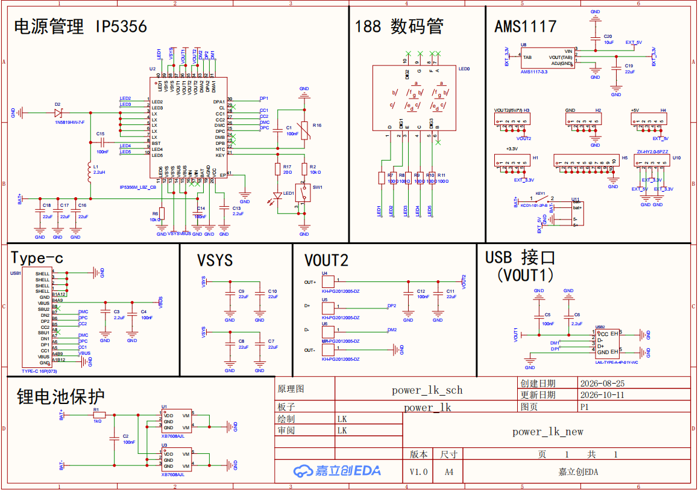
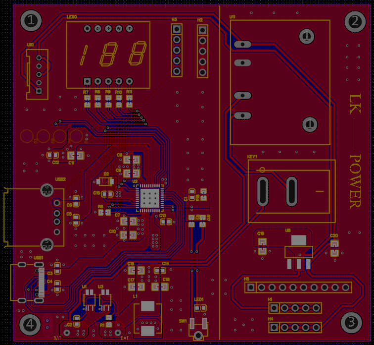

# 🔋 移动电源 PCB 设计

> 基于 **嘉立创 EDA** 开发，采用 **IP5356** 电源管理 SoC，集移动电源功能与多路独立外设供电于一体。

---
## 声明
作者：LK

个人学习项目，不做维护，如果公开部分源码也只是方便自己特殊情况下能随时下载复现。

由于可能会因为各种原因而随时更新源码，请谨慎判别下载。

---
## 📖 项目简介

本项目是一块面向嵌入式与创客场景的 **移动电源 + 多路供电底板**。

核心芯片选用 **IP5356**（英集芯高度集成的移动电源 SoC，内置同步升降压、充电管理、电量指示与多重保护），在提供标准 **5V 移动电源输出（为手机充电）** 的同时，额外引出 **独立的 3.3V 与 5V 电源轨**，可直接为外部单片机、传感器、舵机、直流电机、继电器等各类硬件设备供电，省去额外的电源模块，一块板子即可撑起整个作品。

## 🖼️ 设计预览

### 原理图

### PCB 布局

### ✨ 主要特性

| 特性 | 说明 |
| :--- | :--- |
| 🔌 **手机充电输出** | 标准 5V⎓2A（USB-A），可直接为手机等设备供电/充电 |
| 🔧 **独立 3.3V 输出** | 为单片机、传感器、通信模块等 3.3V 逻辑器件供电 |
| ⚙️ **独立 5V 输出** | 为舵机、直流电机、继电器等功率外设供电 |
| 🛡️ **多重保护** | 过压、过流、过温、短路、电池欠压保护 |
| 🔋 **电池管理** | 支持锂电池充电管理，内置电量指示（LED） |
| 📐 **嘉立创 EDA** | 开源工程文件，可直接导入、修改与下单打样 |

### 原理说明

#### 1. 主控芯片 —— IP5356

IP5356 是英集芯推出的高度集成移动电源专用 SoC，单芯片即可完成：

- **同步升降压变换**：将锂电池 3.0~4.2V 升压稳定在 5V；
- **充电管理**：支持对锂电池恒流/恒压充电，可通过电阻配置充电电流；
- **电量检测与指示**：驱动188数码管显示剩余电量；
- **保护机制**：输入/输出过压保护（OVP）、过流保护（OCP）、过温保护（OTP）、短路保护（SCP）、电池欠压保护（UVP）。

> 💡 设计要点：IP5356 的外围器件精简，只需少量阻容、电感和功率 MOS 即可工作。电感建议选用 **2.2µH ~ 4.7µH 功率电感**，输入输出各配置低 ESR 陶瓷电容以保证环路稳定。

#### 2. 5V 手机供电通道

由 IP5356 内置同步升压直接输出 5V，经 USB-A 母座引出，可同时为手机等 5V 设备充电，满足绝大多数手机快充（5V 档）需求。

#### 3. 独立 3.3V 供电通道

从系统 5V 母线经 **LDO（ AMS1117-3.3 ）** 降压至 3.3V。该路为噪声敏感的逻辑器件（MCU、传感器、无线模块）提供干净稳定的电源。

> ⚠️ 若 3.3V 负载电流较大（>500mA），建议使用 DC-DC 以提升效率、降低发热；轻载场景用 LDO 即可。

#### 4. 独立 5V 外设供电通道

输出的 5V 母线引出独立排针，供电机、舵机、继电器等功率器件使用。**与手机供电通道物理独立**，避免电机启停造成的电压跌落干扰手机充电。

---
## 🧰 接口定义

### 对外供电接口（排针）

| 引脚标识 | 电压 | 最大电流 | 用途 | 备注 |
| :---: | :---: | :---: | :--- | :--- |
| `EXT_3V3` | 3.3V | 500mA* | 单片机、传感器、通信模块 | *取决于所选 LDO |
| `EXT_5V` | 5V | 1A | 舵机、电机、继电器 | 独立引出 |
| `GND` | 0V | — | 公共地 | 所有外设共地 |

### 操作说明

1. **为板子充电**：通过 Micro-USB / Type-C 输入口（依 PCB 封装）接入 5V 电源；
2. **给手机充电**：将手机数据线插入 USB-A 口，自动输出 5V；
3. **外接单片机**：`EXT_3V3` ↔ MCU VCC，`GND` ↔ MCU GND；
4. **外接电机/舵机**：`EXT_5V` ↔ 外设 VCC，`GND` ↔ 外设 GND；
5. **按键**：短按点亮电量指示，长按可开启/关闭输出。

---
## 📦 物料清单（BOM）

> 📋 完整 BOM（含所有阻容、器件型号与嘉立创编码）请见工程目录下的 **`BOM.xlsx`**。

---

  🔋 一块板子，供电全家 —— 让创作更简单。

